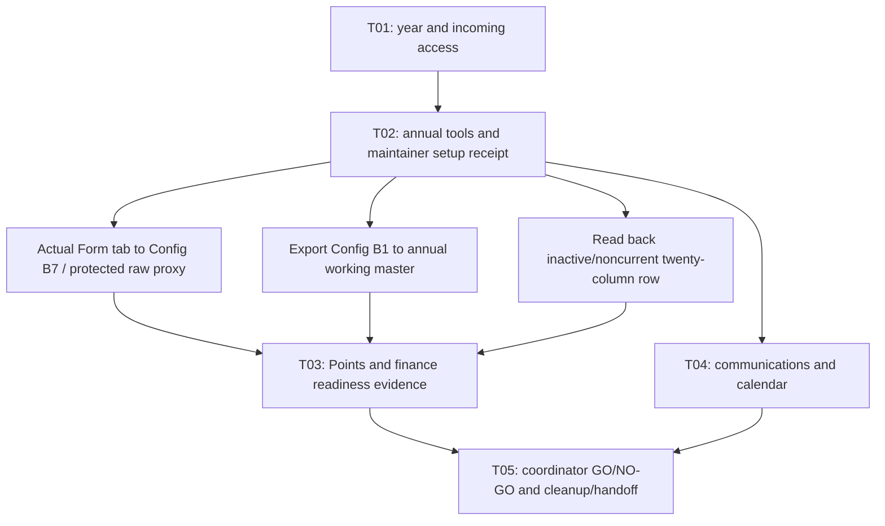

# System flow and ownership

The Hub guides the real officer handoff by default. Incoming officers get access, review their annual tools, confirm Points and finance readiness, prepare communications and agree acceptance. Optional private practice is a separate maintainer exercise; ordinary handoff does not require five fictional submissions. The reviewed AnnualProvisioner creates the annual copies and inactive settings row. Officers compare that row with its private receipt. The Hub reads the chapter’s shared settings; a rehearsal uses its own private copied Control Center. The older authenticated annual-save service remains a separate workflow with its own supported template contract and journal.

The current Guide 11 has five steps.

The shared private checklist is the team record; Hub progress and saved links are local to one device. The President names who copies or imports officer observations into the shared record. Acceptance of the handoff may include assigned open work. Activation requires the separate approved launch record, operator and time.

Maintainer architecture, storage and legacy service reference

After the maintainer confirms the intended configuration, the chapter-admin operator calls `provisionReviewedAnnualYear(year)`; `provision2027_2028` is the editor entry for 2027–2028. The fall term is derived. The maintainer configures chapter root, Control Center, approved positive goal and calendar source once. AnnualProvisioner creates/resumes five private copies, observes Google's actual Form response tab, writes pointers/dates and reads back the inactive row. It performs initial event sync only. The readiness record selects the event-update method and responsible owner. For automatic updates, the chapter operator uses the copied Points Master's bound **ASME Tools → Enable automatic event sync** once, verifies that project's edit trigger and observes a later Events edit update the Form. For approved manual menu sync, the named owner runs **Sync Events to Google Form** after approved Events changes and before intake opens, then verifies the choices. Do not add a second standalone trigger or report manual operation as automatic.

Protected `_Raw_Ingest` reads Config B7; Roster/Point Log use stable proxy references. Both exports centralize import source IDs at Config B1 (six Points/35 Budget formula cells). One-time canonical migration belongs to the maintainer; annual copies do not require bulk formula replacement.

The guide stores seven actual copied-file links, optional mock references and private record URLs by named run on the officer’s device. Format/duplicate/template checks do not certify Google access. Guide versions 2–8 preserve their raw originals during migration to Guide 9; passed checks reopen. A rehearsal or imported completion never authorizes production T05. A rehearsal can reach its separate completion GO after all 16 applicable checks pass, T01–T04 complete and T05 is skipped with a reason. Real handoff has 20 applicable reviews, excluding the six fictional exercise checks, and requires separate launch approval. Cleanup/handoff remains available while production is NO-GO.

The older authenticated annual-save service is a separate configured workflow. It does not adopt provisioner-created rows or validate the proxy/Config B1 import architecture; do not send those years through it. Its supported independent workflow is: **Open authorized annual save**, **Verify with Google**, review the public twenty-cell row/audience, **Save inactive year and confirm**, then independent **Compare with Google**. Its installation receipt does not certify the new helpers. Neither route activates the year, opens intake, grants sharing or approves a send.

See [current implementation and verification status](current-implementation.md) for the exact checks, local save/export boundaries and installation limits.

## Hosting and storage

Rehearsal T02 saves a private copied Control Center and optional provisioner-project editor reference alongside its seven links. **Compare saved links with setup summary** validates and retains that run’s browser draft, then offers direct native row comparison against the provisioner receipt. It never calls the legacy writer or switches the production settings source. Private reference fields are excluded from progress export and print. All access, permissions and exact saved values still need Google readback.

| Component | Host/control | What is stored there |
|---|---|---|
| Hub website and source | ASME-OSU GitHub organization / GitHub Pages | Public HTML, browser scripts, defaults and documentation |
| Annual Verify and Save service | Chapter-owned standalone Google Apps Script project | Authenticated server code; self-only deployment running as the accessing chapter account |
| Control Center | Chapter Google Drive / Sheets | Shared `Hub_Settings_Public` rows; the entire workbook is publicly readable |
| Templates and annual copies | Chapter Google Drive | Canonical masters and new-year files; private masters are separate from reviewed public exports |
| Rules, ledgers and operational evidence | Chapter's private administrative/handoff folders | Trusted configuration, operation history, source snapshots and acceptance records |
| Guide progress, link drafts, personal links | Each officer's browser | Local state; export/import is needed to move it between devices |
| Other officer tools | Existing Ohio State, Microsoft 365, newsletter and finance services | Separate accounts and access controls; their ownership/access is not certified by this save service |

The Google project's owner was checked as the ASME chapter account, with
restricted access. The Hub lives in ASME-OSU's GitHub organization. There is no
additional personal hosting server. A developer's Git author name is different
from ownership of the Google files. The Hub access phrase and role selector do
not grant Google or Microsoft authorization.

## Existing authenticated annual-save verification scope

Google verification checks file identity, type, chapter ownership, editability,
folder ancestry, allowed permissions and excluded templates/originals/fixtures.
It checks a closed Form and its actual destination, response headers and empty
test body, Points configuration, budget dates, export schemas and the complete
reviewed import-formula inventory. The save engine checks the settings schema,
unique years, active/current flags and an unchanged baseline. Its review expires
after 30 minutes; save takes the project lock and checks resources again.

Officers still check response delivery/scoring, bound scripts and triggers,
public export contents, finance totals/authority, incoming access and independent
consumers. The service does not mark those checks PASS, open responses, change
sharing or activate a year. See the [verification contract](../../integrations/apps-script/MANUAL_ANNUAL_VERIFICATION.md)
for the exact conditions.

The public data flow is **attendance Form → private Points Master → reviewed
Points Export → Hub**, with **private Budget Tracker → Budget Export → Hub**.
The Hub also reads shared settings and the public chapter calendar. Published
settings contain public references even when the linked destination is private;
hidden tabs do not protect anything in a publicly readable workbook.

For current-year gear-panel edits, **Preview and refresh** affects that browser
tab. **Edit shared settings** opens Google Sheets for an authorized shared edit;
**Compare with Google** checks the intended saved values. For a provisioner-created year, compare its exact existing row directly against its private receipt. The legacy writer has a separate append journal and cannot adopt that row. Keep the two workflows and receipts distinct.

